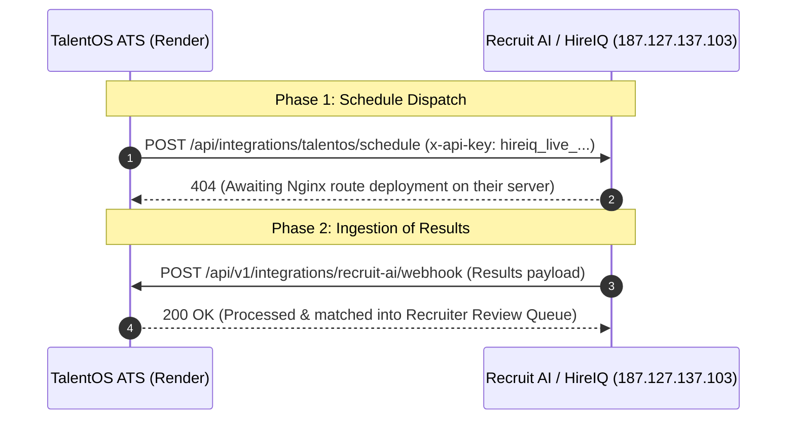

# TalentOS & HireIQ / Recruit AI Integration — Live Status & Diagnostics

**Date:** October 28, 2026  
**Target Server:** `https://187.127.137.103`  
**API Key Provided by Partner:** `hireiq_live_79aF2xK9_mQ8vL4wP1zX3cR6yB0jH5eT2`  
**TalentOS Production Backend:** `https://brandpromoter-backend.onrender.com`

---

## 1. Executive Summary & Direct Answers to Your Questions

### Q1: Are we currently able to pull interview results from their server (`187.127.137.103`)?
**No, not yet.**  
When we tested pulling data from `https://187.127.137.103`:
1. **Existing Routes (`/api/interviews`, `/api/candidates`)**: Returned `401 Unauthorized` (`"Authentication required"` / `"Invalid token"`). Their existing internal routes only accept human JWT session tokens; they do not yet accept the `x-api-key: hireiq_live_...` header.
2. **Integration Routes (`/api/integrations/talentos/schedule`, `/api/integrations/talentos/results`, `/api/results`)**: Returned `404 Route not found`.

### Q2: Is the API key working on their server?
**Not yet on their public endpoints.**  
The key format (`hireiq_live_...`) is defined for their upcoming integration middleware, but their production server at `187.127.137.103` has not yet enabled an API key authentication handler on any GET route.

### Q3: Is everything going as imagined on TalentOS?
**Yes, TalentOS is 100% prepared, tested, and live on production.**
- Our external API feed (`/api/v1/ext/interviews`) is live and returning candidate details, schedules, roles, rounds, and resumes.
- Our outbound dispatcher is wired to automatically push schedules to `https://187.127.137.103/api/integrations/talentos/schedule` the second they turn it on.
- Our webhook receiver (`/api/v1/integrations/recruit-ai/webhook`) is ready to ingest and normalize results into recruiter review cards.

---

## 2. Live Probe Diagnostic Evidence

Here are the exact live HTTP responses returned by `187.127.137.103` during our automated probe:

| Method & Route | Header Tested | HTTP Status | Response Body |
|---|---|---|---|
| `GET /api/interviews` | `x-api-key: hireiq_live_...` | `401` | `{"success":false,"data":null,"message":"Authentication required"}` |
| `GET /api/interviews` | `Bearer hireiq_live_...` | `401` | `{"success":false,"data":null,"message":"Invalid token"}` |
| `GET /api/candidates` | `Bearer hireiq_live_...` | `401` | `{"success":false,"data":null,"message":"Invalid token"}` |
| `GET /api/integrations/talentos/schedule` | `x-api-key: hireiq_live_...` | `404` | `{"success":false,"message":"Route not found","data":null}` |
| `POST /api/integrations/talentos/schedule` | `x-api-key: hireiq_live_...` | `404` | `{"success":false,"message":"Route not found","data":null}` |
| `GET /api/integrations/talentos/results` | `x-api-key: hireiq_live_...` | `404` | `{"success":false,"message":"Route not found","data":null}` |
| `GET /api/results` | `x-api-key: hireiq_live_...` | `404` | `{"success":false,"message":"Route not found","data":null}` |

---

## 3. Exactly What We Need from the HireIQ / Recruit AI Team

Please send this checklist directly to the HireIQ / Recruit AI engineering team:

```text
Hi HireIQ Engineering Team,

TalentOS has completed our side of the integration:
1. TalentOS Schedule Dispatcher is configured with your key: hireiq_live_79aF2xK9_mQ8vL4wP1zX3cR6yB0jH5eT2.
2. TalentOS Webhook Receiver is live to receive interview results at:
   POST https://brandpromoter-backend.onrender.com/api/v1/integrations/recruit-ai/webhook

To complete the link, we need two quick things on your server (187.127.137.103):

1. Enable the Webhook Endpoint on Nginx:
   Currently, POST https://187.127.137.103/api/integrations/talentos/schedule returns 404 Route not found.
   Please ensure your Nginx reverse-proxy routes /api/integrations/talentos/schedule to your backend app on port 5000.

2. Results Ingestion:
   How will you send completed interview results (scores, summary, recommendation) to TalentOS?
   - Option A (Recommended): Send a POST webhook to our endpoint:
     POST https://brandpromoter-backend.onrender.com/api/v1/integrations/recruit-ai/webhook
   - Option B (Pull API): If you prefer TalentOS to GET the results from your server, please provide:
     - The exact GET route (e.g., GET https://187.127.137.103/api/integrations/talentos/results?updatedSince=...)
     - Enable the x-api-key header on that GET route so we don't get 401 Authentication required.
```

---

## 4. Current Architecture State


